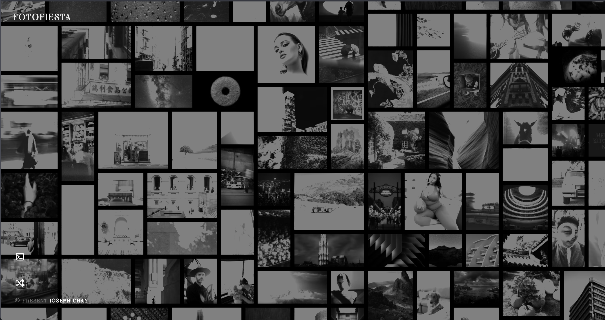
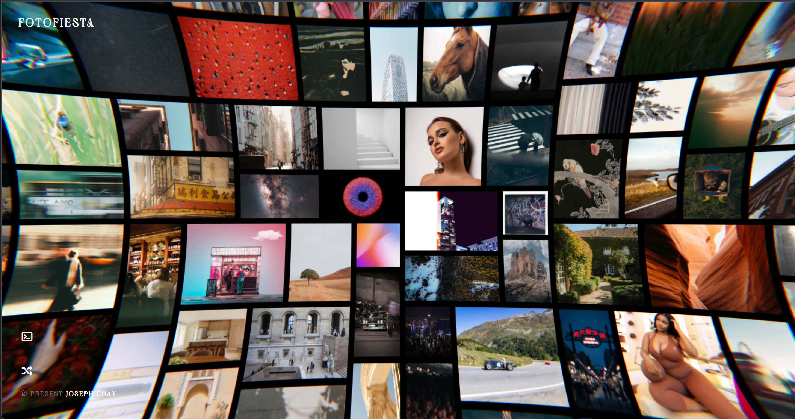
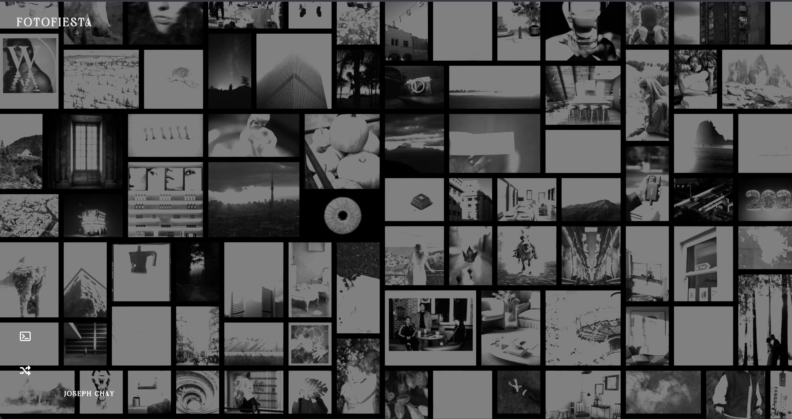
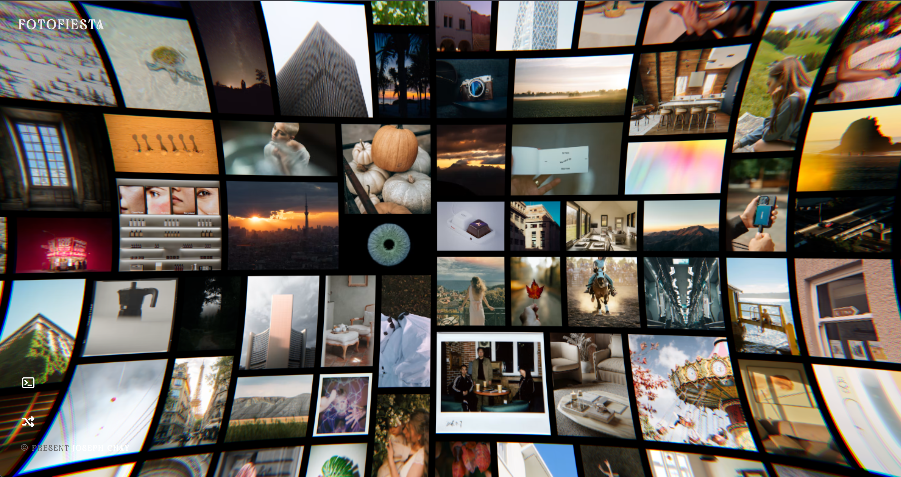
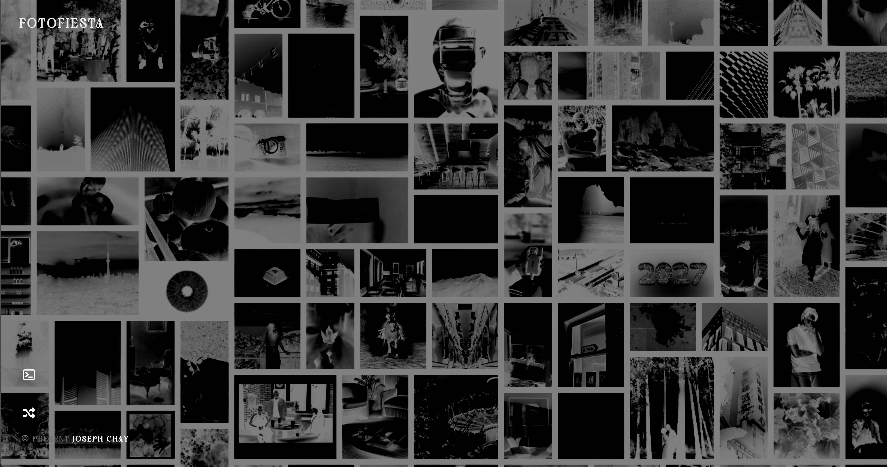
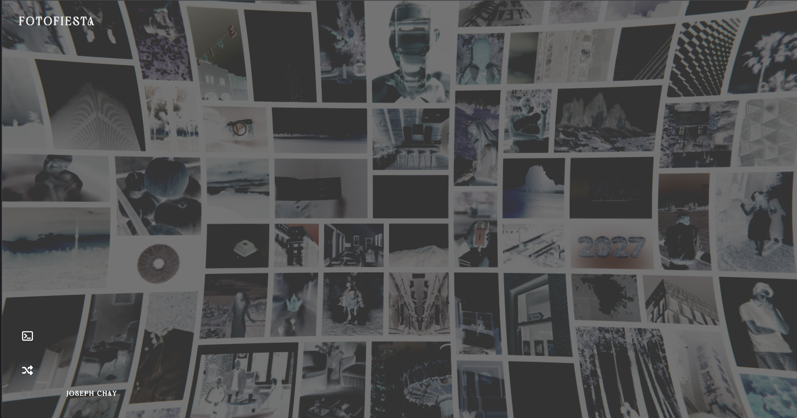
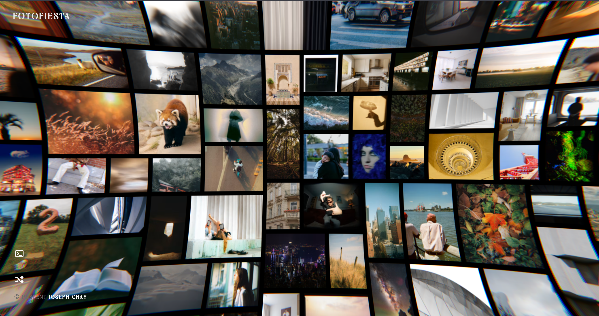

# FotoFiesta - Adaptation of Unsplash

## About

Attempt to recreate photography library feature for https://unsplash.com/

## Prerequisites

Documentation: https://unsplash.com/documentation

Applications for API Keys: https://unsplash.com/oauth/applications

According to Claude AI Chat https://claude.ai/share/2af65b89-f5d0-40ed-93dc-2e14ad323e83:
1. Access Key (public): identifies your app. It's all you need for public actions like fetching photos, and it's what your code uses.
2. Secret Key (private): used only in the OAuth flow, to exchange an authorization code for a user's access token. You need it only if your app acts on behalf of a logged-in Unsplash user, for example to like photos, manage their collections or upload photos.

## Demo









[](https://josephchay.github.io/fotofiesta/)

## Tech Stack

 &nbsp;
 &nbsp;
 &nbsp;
 &nbsp;
 &nbsp;

## Development

Clone the repository:

```bash
git clone https://github.com/josephchay/fotofiesta
```

Navigate to the project directory:

```bash
cd fotofiesta
```

Run 
```
npm i
npm start
```

> [!NOTE]
> Paste your Unsplash Access Key into the terminal when prompted. Do not use your Secret Key.

## Trivia

### Synopsis

Explore an endless gallery of captivating photography that surrounds you. Immerse yourself in the beauty of an infinite scrolling showcase

### Content

Introducing **FotoFiesta** – where the possibilities are as boundless as your imagination!
Immerse yourself in an infinite world of captivating visuals,
where every snapshot tells a unique story. Our photo gallery transcends boundaries,
offering an endless voyage through the artistry of pixels.
From the vibrant colors of sunrise to the moody elegance of dusk,
**FotoFiesta** is the portal to an ever-expanding universe of breathtaking moments.
Unleash your creativity, share your visual narratives, and join a community where the excitement is limitless.
Get ready for an extraordinary journey through an infinite photo gallery that celebrates the magic of every click,
ensuring that the art of photography knows no bounds. **FotoFiesta** – where your memories find eternity.
